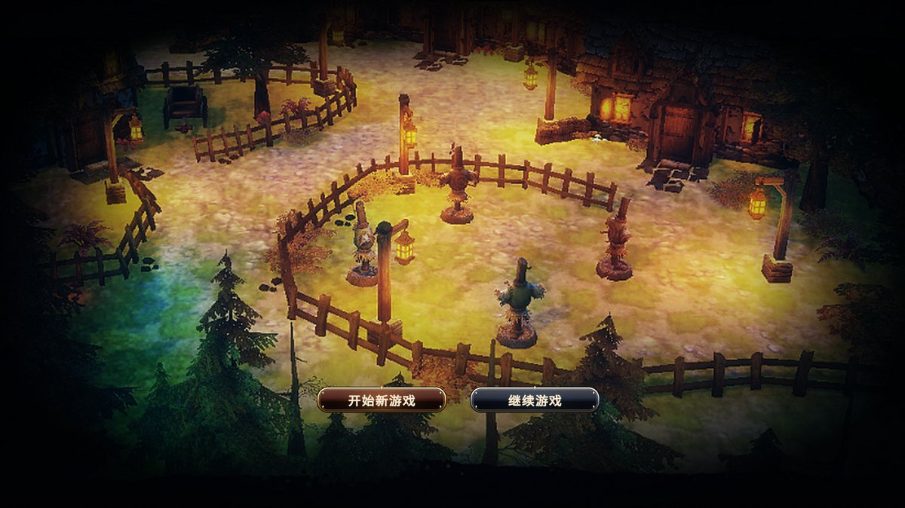
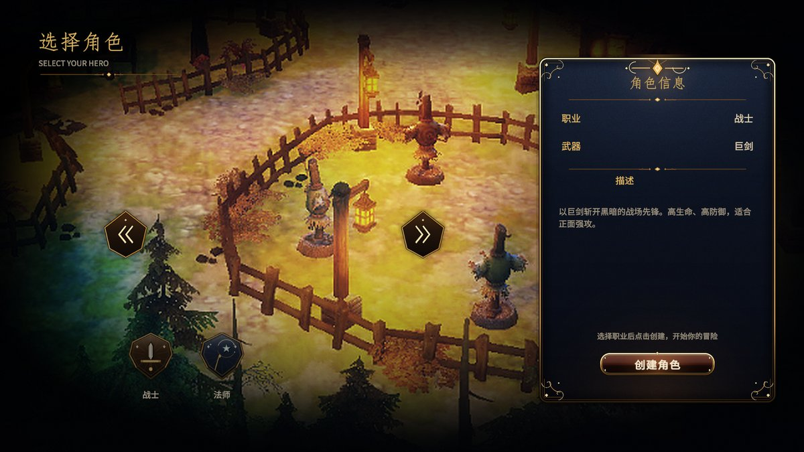
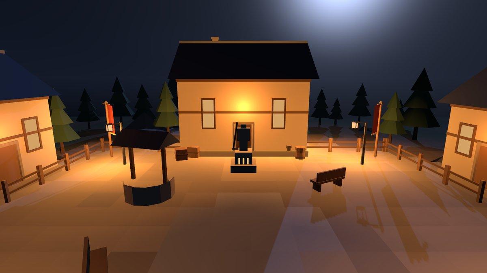
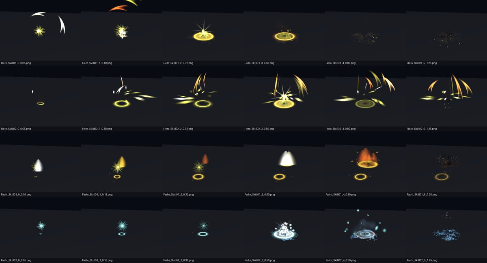
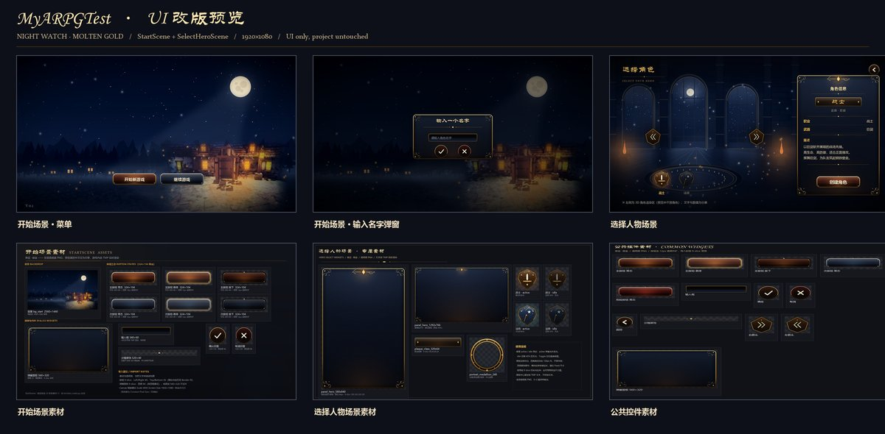

# MyARPGTest · 动作角色扮演游戏 Demo

> 一个基于 **Unity 2022.3 LTS** 的动作角色扮演游戏（ARPG）练习项目。
> 包含第三人称战斗、技能系统、动画事件、UI 流程、程序化场景搭建、数据存档等完整模块。

## 预览

| 开始界面 | 角色选择 |
|---|---|
|  |  |

| 主城场景 | 战斗场景 |
|---|---|
|  |  |

| 技能表现 | UI 素材 |
|---|---|
|  |  |

## 技术栈

- **引擎**：Unity 2022.3.55f1c1（内置渲染管线，PC / Android 均构建过）
- **语言**：C#
- **UI**：uGUI + TextMeshPro（自带 SDF 中文字体、九宫格 NineSlice）
- **数据**：SQLite（`Assets/StreamingAssets/ARPG.db`）+ ScriptableObject 技能配置
- **框架特性**：对象池、有限状态机（FSM）、动画事件、事件中心、Resources 配置映射
- **相机**：自写第三人称相机（右键转视角 / 滚轮缩放）

## 功能模块

| 模块 | 说明 | 主要文件 |
|---|---|---|
| 技能系统 | 4 个技能（裂地斩 / 旋风斩 / 烈焰风暴 / 霜华新星），冷却、消耗、范围判定、对象池 | `MyScript/MyHelper/SkillFrameWork/` |
| 技能数据 | 技能从数据库迁移到 ScriptableObject，Inspector 直接配数值 | `Resources/SkillConfig/Job*_SkillSet.asset` |
| 技能特效 | 4 个表现 prefab，按时间轴依次播放起手 / 命中 / 余留，带点光闪光 | `MyPerfabs/Skill/`、`SkillEffectSequencer.cs` |
| 动画事件 | 通用 `AnimationEvent` 桥 + `CharacterSkillSystem`，命中帧触发技能表现 | `AnimationEvent.cs`、`CharacterSkillSystem.cs` |
| 战斗 | 连招输入、受击/死亡、敌人 AI 状态机、血量 HUD | `MyScript/MyHelper/` |
| 第三人称相机 | 相机与角色根节点平级，角色转身不影响视角；WASD 相对相机方向移动 | `ThirdPersonCameraController.cs`、`CharacterMotor.cs` |
| UI 流程 | 开始界面 → 输入角色名 → 选择角色 → 主城 / 战斗 | `Scenes/` |
| 场景 | 程序化生成的主城与战斗场景（顶点色 + 自定义 Shader、实时灯光、雾） | `MyRes/GeneratedEnv/` |

## 目录结构

```
Assets/
├─ MyScript/              游戏代码（核心逻辑、UI、技能、数据）
├─ Scenes/                场景：StartScene / SelectHeroScene / UIMainCity / BattleScene / GameMain / LoadindScene
├─ MyPerfabs/             预制体（角色、技能、场景物件）
├─ Resources/             运行时 Resources.Load 资源（角色、技能、技能配置）
├─ MyRes/                 美术资源：模型、材质、贴图、字体、音效、程序化生成环境/UI
├─ StreamingAssets/       数据库与配置表
├─ PlayerPart/            输入系统与角色 Animator Controller
├─ Plugins/               第三方插件（Joystick Pack 等）
└─ TextMesh Pro/          TMP 基础资源
Docs/screenshots/         README 截图
Packages/                 Unity 包依赖
ProjectSettings/          工程设置
```

## 运行方式

1. 使用 **Unity 2022.3.55f1c1**（或同系列 2022.3 LTS）打开本目录；
2. 打开 `Assets/Scenes/StartScene.unity`，点 Play 即可从开始界面体验完整流程；
3. 若只想看战斗：打开 `Assets/Scenes/BattleScene.unity` → Play。

> 仓库没有提交 `Library/`、`Temp/` 等自动生成目录，首次打开 Unity 会重新导入资源，属正常现象。

## 说明

- 技能数据在 `Assets/Resources/SkillConfig/`，改数值直接在 Inspector 里改，无需动代码。
- 场景中的程序化环境素材在 `Assets/MyRes/GeneratedEnv/`（模型 / 预制体 / 材质 / Shader）。
- 角色动画事件统一为 `SkillTrigger`，挂在 Animator 同物体的 `AnimationEvent` 组件上。
- 工程中第三方资源（TextMeshPro、Joystick Pack、Standard Assets 特效、Noto Sans SC / 仿宋字体）版权归原作者所有。

## License

本项目仅用于学习与技术交流。
