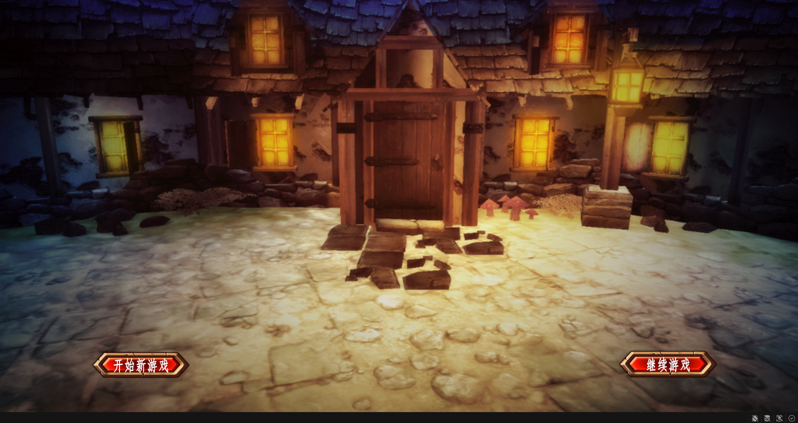
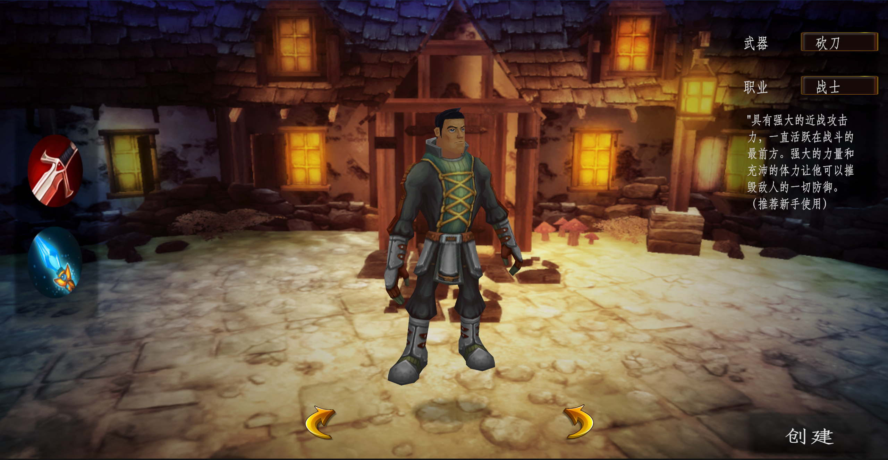
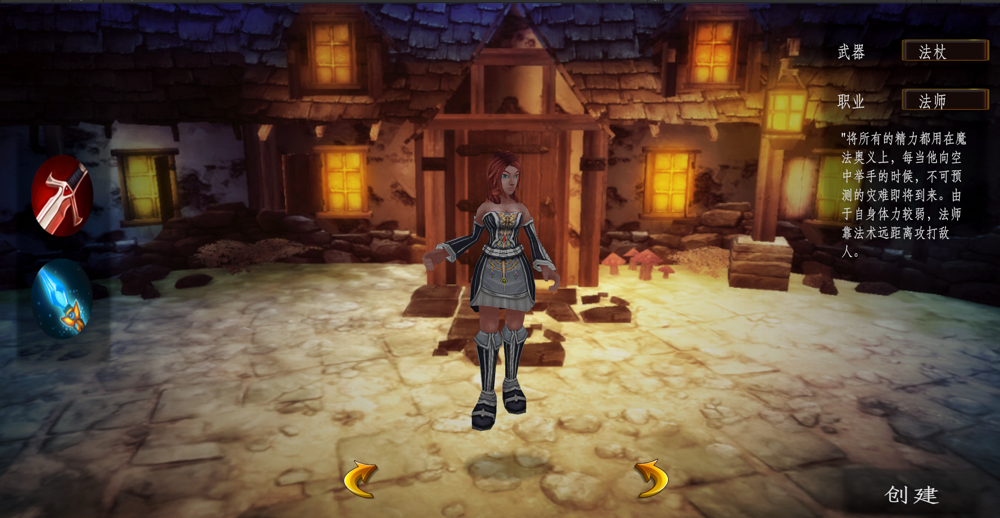
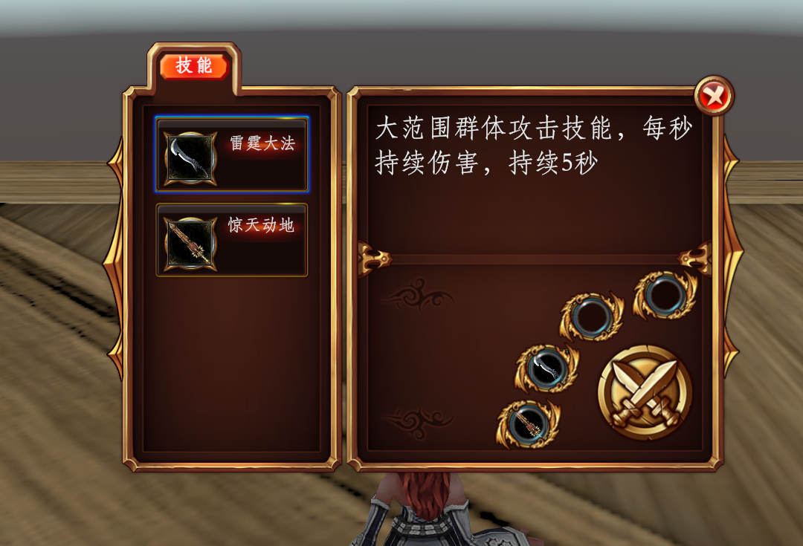

# ARPG-Demo

基于 Unity 的动作角色扮演游戏战斗练习项目，实现了技能系统、UI 框架、有限状态机、对象池等核心模块。

## 游戏流程

### 1. 开始界面
提供「开始新游戏」与「继续游戏」入口。实现简单的数据存档

### 2. 角色选择
选择不同角色按钮，展示角色，显示角色信息

**战士** —— 近战输出职业，武器为砍刀，拥有强大的力量与体力，可正面摧毁敌人防御，推荐新手使用。

**法师** —— 远程输出职业，武器为法杖，自身体力较弱，依靠法术进行远距离范围攻击。

### 3. 技能选择面板
为角色选择技能，到战斗场景中会读取配置的数据，灵活配置

### 4. 角色技能演示视频

[▶ 点击查看 Demo 演示视频](GameImage/屏幕录制%202026-10-30%20153545.mp4)

## 核心技术

- **有限状态机（FSM）**：统一管理角色待机、移动、攻击、追击、死亡等状态切换，状态间解耦。
- **技能系统**：配置驱动的技能释放逻辑，支持群体伤害、持续伤害、冷却管理等效果，支持多种技能判定方式
- **UI 框架**：实现简单UI框架，使用窗口管理交互元素，减少耦合。
- **对象池**：统一管理子弹、技能特效等高频创建对象，减少运行时 GC。
- **设计模式实践**：单例、工厂、对象池等在战斗系统中的实际落地。
